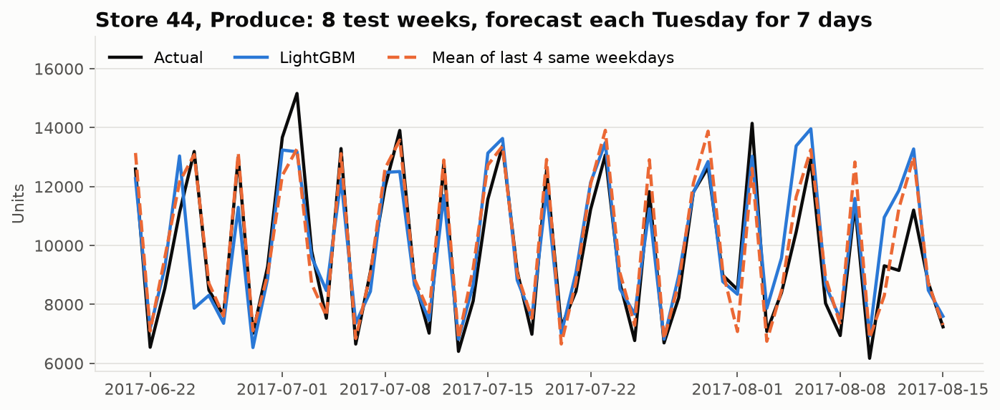
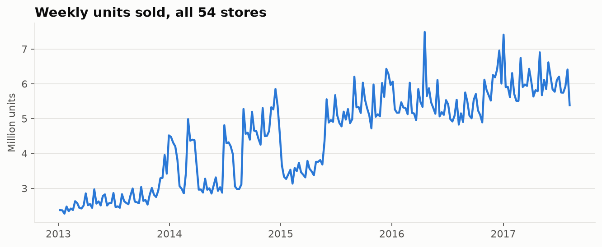
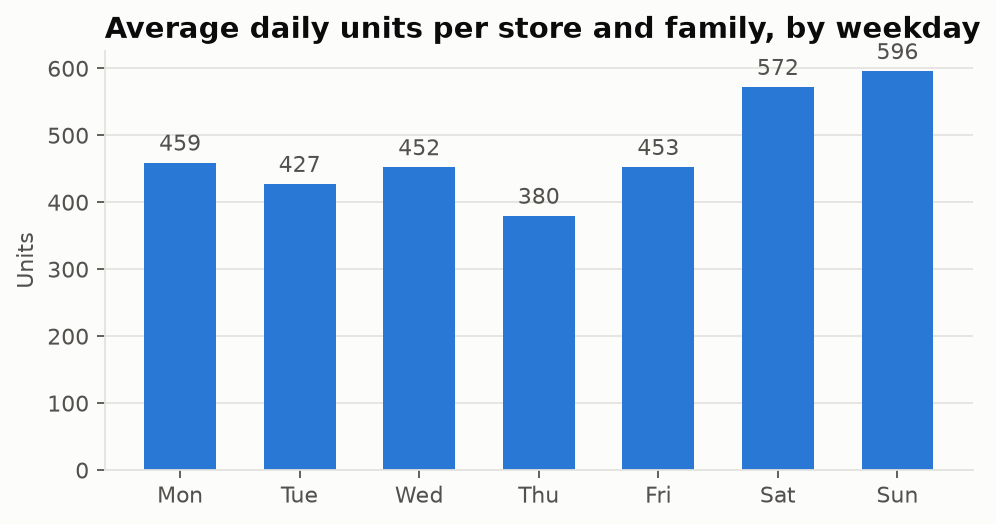
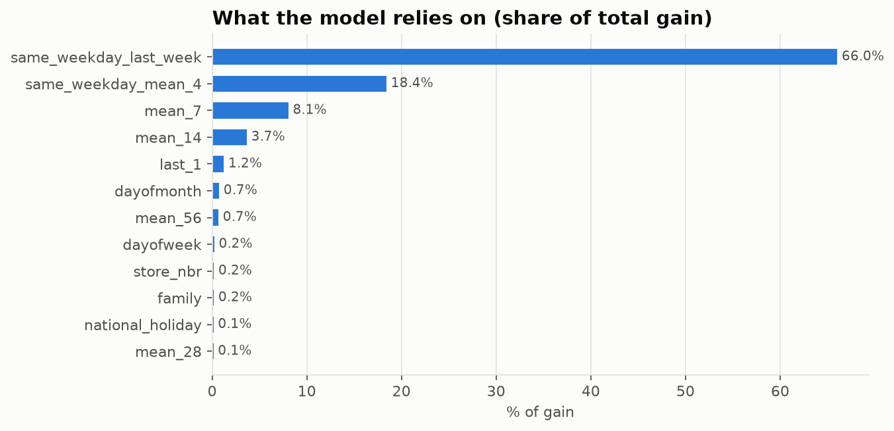
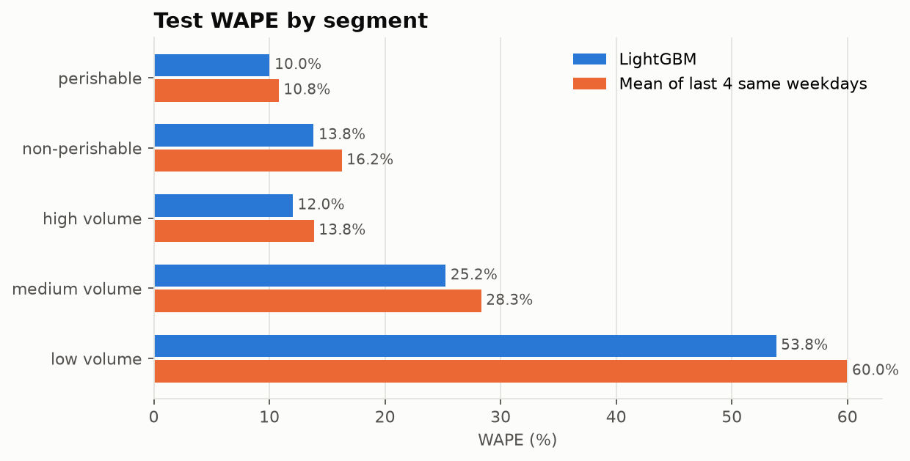
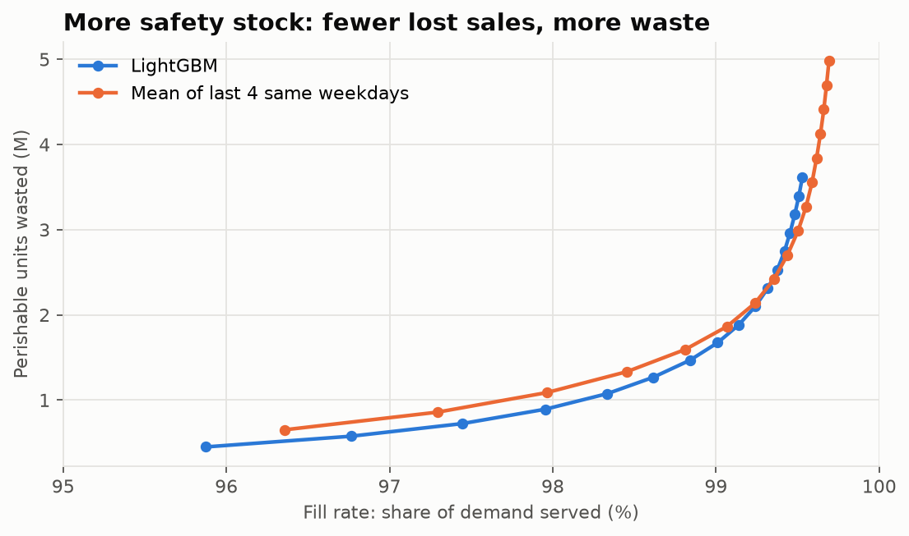

# Retail Demand Forecasting

**Status: ACTIVE**

**Live dashboard:** https://pantelistsagkas-retail-demand-forecasting-app-glbgah.streamlit.app/

Forecasting daily grocery demand for 54 supermarkets and 33 product families, then testing whether a better forecast actually means less waste on the shelf. Built on 125 million rows of real supermarket sales with a DuckDB pipeline, three honest baselines, LightGBM, and an inventory simulation.



## Headline results

On 8 weeks of held-out test data (21 June to 15 August 2017) that played no part in training or model choice:

| Model | MAE | RMSE | WAPE | RMSLE | Bias |
|---|---|---|---|---|---|
| Last day | 129.3 | 485.2 | 27.3% | 0.586 | -8.4% |
| Same weekday last week | 85.1 | 320.8 | 18.0% | 0.530 | +1.1% |
| Mean of last 4 same weekdays | 68.4 | 250.9 | 14.4% | 0.445 | +1.7% |
| **LightGBM** | **59.5** | **237.0** | **12.6%** | **0.395** | **-0.5%** |

- LightGBM cuts WAPE by 13% relative to the best baseline (14.4% to 12.6%), and beats it on 87% of the 1,686 store-family series with sales in the test period.
- Its bias is close to zero: it neither over- nor under-forecasts in total.
- In the inventory simulation, at the same 98% fill rate, LightGBM's forecasts lead to 17% less perishable waste and 18% less leftover stock than the best baseline. At a 99% fill rate the gap shrinks to 7% and 9%.

## The problem

A supermarket chain orders stock for every store, every week. If the forecast is too low, shelves go empty and sales are lost. If it is too high, stock piles up and fresh food is thrown away. This project asks two questions: how much does a machine learning model improve on simple rules a planner could use in a spreadsheet, and what does that improvement mean for stock decisions?

## Data

[Corporación Favorita Grocery Sales Forecasting](https://www.kaggle.com/competitions/favorita-grocery-sales-forecasting) on Kaggle: daily unit sales per item and store from a supermarket chain in Ecuador, from January 2013 to August 2017. That covers 125,497,040 rows, 4,100 items in 33 product families, 54 stores, and holiday, store and oil price data.

This is public Ecuadorian data, not data from any other retailer. The raw files are not committed, because Kaggle's rules do not allow redistribution.

What the data looks like:





Weekends drive demand: Sunday is the busiest day and Thursday the quietest. The sharp dips in 2014 and early 2015 are not real. Several families, including PRODUCE and BEVERAGES, are missing from the raw data for long stretches (PRODUCE sold 3.5M units in December 2014 and 8K in February 2015). The data is complete again from 1 June 2015, so every training window starts after that date.

## Approach

### 1. Pipeline (DuckDB + SQL)

`uv run ingest` loads the six CSVs (5 GB) into DuckDB with explicit column types in about 6 seconds, then runs SQL data quality checks before anything else happens:

- one row per date, store and item
- no null keys
- every store and every item exists in its reference table
- perishable flag is 0 or 1

If any check fails, the pipeline stops. The SQL transform then builds the modelling tables:

- **family_daily:** units per store, family and day. The raw file only holds rows where something sold, so the transform rebuilds the full calendar grid from each store's opening date and fills unsold days with zero. Returns (negative sales) are excluded, as they are not demand. 2.79M rows, 1,782 series.
- **family_info:** marks a family as perishable when most of its items are.
- **store_calendar:** national, regional and local holiday flags per store, matched on the store's city and state. Transferred holidays are handled correctly.

### 2. Forecast setup

Every Tuesday, the model forecasts the next 7 days for every store and family, using only data up to that Tuesday. Origins are weekly and split strictly in time:

| Period | Forecast origins | Used for |
|---|---|---|
| Train | 91 weeks, 28 Jul 2015 to 18 Apr 2017 | Fitting |
| Validation | 8 weeks, 25 Apr to 13 Jun 2017 | Early stopping, safety stock sizing |
| Test | 8 weeks, 20 Jun to 8 Aug 2017 | Final scores, touched once |

No target day appears in two periods. After validation picks the number of trees, the model is refitted on train plus validation and scored once on test.

**Leakage control.** Every feature is computed from days up to the forecast origin. A unit test proves it: it overwrites every value after the origin with 9999 and checks that the features do not change.

### 3. Baselines

A model is only worth running if it beats simple rules, all scored on exactly the same rows:

1. **Last day:** repeat the most recent day.
2. **Same weekday last week:** the value 7 days before the target day.
3. **Mean of last 4 same weekdays:** the average of the same weekday over the past 4 weeks.

### 4. Model

LightGBM trained on log(1 + units), which makes it optimise a log error similar to RMSLE so that small and large series both count. Features:

- **Recent level:** means over 7, 14, 28 and 56 days, the last day, 28-day volatility and the share of zero days.
- **Weekly pattern:** same weekday last week and the mean of the last 4 same weekdays.
- **Calendar:** forecast horizon, weekday, day of month, payday (Ecuador's public sector is paid on the 15th and the last day of the month), and holiday and event flags.
- **Store and product:** store, family, store type, store cluster, perishable.



The weekly pattern dominates: same weekday last week and the 4-week same weekday mean account for 84% of total gain. The model's edge over the best baseline comes from combining those with the recent level and the calendar, not from any single exotic feature.

**Promotions are deliberately left out.** In this dataset the promotion flag is only recorded for items that sold that day, so a "share of items on promotion" feature partly encodes the answer. In production the full promotion plan is known in advance, and it would be the first feature to add.

### 5. Evaluation

Five metrics, because each one hides something:

| Metric | What it shows |
|---|---|
| MAE | Average miss in units |
| RMSE | Punishes large misses more |
| WAPE | Total miss as a share of total demand, the main business metric |
| RMSLE | Relative error, so small series count as much as large ones |
| Bias | Systematic over (+) or under (-) forecasting |

Overall numbers can hide weak spots, so test results are also split by segment:



- The model helps most on non-perishable series (16.2% to 13.8%) and high-volume series (13.8% to 12.0%).
- On perishables the gain is smaller (10.8% to 10.0%), because fresh food already follows a very stable weekly rhythm that the baseline captures well.
- Low-volume series stay hard for every model (54% WAPE). These are intermittent products like BOOKS or BABY CARE, which need a different approach (see next steps).

The example chart at the top is one of the series where the baseline actually does better (store 44, Produce: 6.3% against 8.6%). The model wins on 87% of series, not all of them.

### 6. Inventory simulation

A better forecast only matters if it changes a decision. The simulation runs a weekly order-up-to policy for every store and family over the 8 test weeks:

- Each week, stock up to the 7-day forecast plus safety stock.
- Safety stock = z x the standard deviation of that model's own weekly errors on the validation weeks.
- Demand that cannot be served is lost. Unsold perishables are thrown away at the end of the week. Non-perishables carry over.

Comparing models at one fixed z is misleading: the model with bigger errors gets bigger buffers, serves more demand and wastes more, so neither looks clearly better. Instead the simulation sweeps z from 0 to 4 and compares models at the **same fill rate**:



| Fill rate | Perishable waste, best baseline | Perishable waste, LightGBM | Change |
|---|---|---|---|
| 97% | 793K units | 627K units | -21% |
| 98% | 1.11M units | 915K units | -17% |
| 99% | 1.79M units | 1.66M units | -7% |

The benefit shrinks as the target fill rate rises: near 100% service, safety stock dominates and both curves converge. Ordering weekly also adds up daily errors, which hides some of the model's day-by-day advantage. **Lesson: forecast accuracy does not translate one-for-one into business value. It depends on the replenishment policy.**

## Limitations

- **Family level, not item level.** Real replenishment happens per item. Family totals are smoother and easier to forecast than single products.
- **Mixed units.** Some items are sold by weight, so family totals mix kilograms and units. Error percentages are fine, but absolute unit counts are approximate.
- **Simplified inventory.** No lead times, no shelf life beyond one week, no costs. The simulation compares models fairly, but it is not a cost estimate.
- **One test window.** 8 summer weeks in 2017. A rolling backtest across seasons, including Christmas, would be stronger.
- **No promotions** (see above).

## Next steps

- Rolling-origin backtest over a full year.
- Item-level forecasts for the top families on the full 125M rows, using DuckDB for feature generation.
- A dedicated model for intermittent demand (Croston-type methods or a zero-inflated objective).
- Promotion features built from a clean promotion calendar.
- Daily replenishment simulation with lead times and real shelf lives per family.

## Running it

```bash
# 1. Data: on Kaggle, accept the competition rules and download the data zip.
#    Unzip it, then extract each .7z file into data/raw/ (train.csv is 5 GB):
uvx py7zr x path/to/train.csv.7z data/raw     # repeat for each .7z file

# 2. Pipeline, experiment, figures (LightGBM on macOS needs: brew install libomp)
uv sync
uv run ingest       # CSVs -> DuckDB, quality checks, modelling tables
uv run forecast     # baselines + LightGBM + inventory simulation -> reports/
uv run figures      # charts -> reports/figures/

# 3. Dashboard
uv run streamlit run app.py

# Tests (small fake data, no download needed)
uv run pytest
```

On an M-series MacBook: ingest about 6 seconds, forecast about 1 minute.

## Dashboard

`app.py` is a Streamlit app, [live here](https://pantelistsagkas-retail-demand-forecasting-app-glbgah.streamlit.app/), for exploring the results: pick any store and family to see forecast against actual sales, the error tables by model and segment, and the inventory trade-off curve.

## Project layout

```
src/retail_demand/
  ingest.py      CSVs -> DuckDB with explicit types
  checks.py      SQL data quality checks
  transform.py   SQL: item rows -> store x family daily grid, holiday flags
  panel.py       DuckDB -> series x day matrix
  features.py    leakage-safe features, time-ordered splits
  model.py       baselines and LightGBM
  metrics.py     MAE, RMSE, WAPE, RMSLE, bias
  inventory.py   order-up-to simulation, fill rate vs waste sweep
  evaluate.py    runs the whole experiment
  figures.py     README charts
app.py           Streamlit dashboard
tests/           31 tests: SQL transforms, leakage, splits, metrics, inventory
reports/         metrics, predictions and figures (generated)
```

Tooling: uv, ruff, ty and pytest, all passing.
